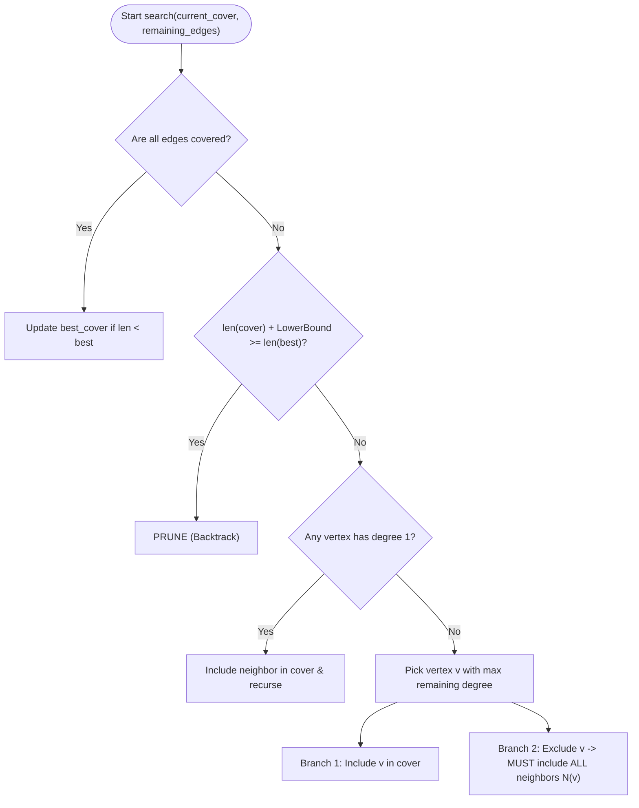

# 🛡️ Aegis: Architecture, Mathematical Foundations & Engineering Documentation

This document explains the concepts, mathematical principles, algorithmic mechanics, and network ingestion models behind **Aegis**.

---

## 📑 Table of Contents
1. [What is Aegis?](#1-what-is-aegis)
2. [The Cybersecurity Problem Formulation](#2-the-cybersecurity-problem-formulation)
3. [The Minimum Vertex Cover (MVC) Problem](#3-the-minimum-vertex-cover-mvc-problem)
4. [Algorithm Deep Dive: How Each Solver Works](#4-algorithm-deep-dive-how-each-solver-works)
   - [4.1 Exact Solver: Branch-and-Bound with Pruning](#41-exact-solver-branch-and-bound-with-pruning)
   - [4.2 2-Approximation Solver: Maximal Matching](#42-2-approximation-solver-maximal-matching)
   - [4.3 Greedy Degree Heuristic](#43-greedy-degree-heuristic)
5. [Network Ingestion & Topology Reconstruction](#5-network-ingestion--topology-reconstruction)
   - [5.1 The Subnet Clique Problem](#51-the-subnet-clique-problem)
   - [5.2 Hierarchical Infrastructure Model](#52-hierarchical-infrastructure-model)
   - [5.3 Live Scanning via Nmap](#53-live-scanning-via-nmap)
6. [Benchmarking & Empirical Proofs](#6-benchmarking--empirical-proofs)
7. [System Architecture & Module Flow](#7-system-architecture--module-flow)
8. [Practical Usage Guide](#8-practical-usage-guide)

---

## 1. What is Aegis?

**Aegis** is a network defense optimization system that solves the optimal sensor and firewall placement problem using graph-theoretic algorithms.

In any computer network:
- Devices (routers, switches, servers, workstations, IoT devices) are **vertices** ($V$).
- Active communication channels (Ethernet cables, Wi-Fi links, route hops) are **edges** ($E$).

Every link in the network can carry malicious traffic (lateral movement, port scans, malware propagation, data exfiltration). To guarantee that **every single link is inspected**, security sensors (such as Zeek, Snort, or eBPF packet monitors) must be deployed.

However, placing sensors on every device is expensive in hardware, licensing, and CPU overhead. Aegis finds the **smallest possible subset of devices** that guarantees 100% link coverage.

---

## 2. The Cybersecurity Problem Formulation

Consider an enterprise network with $n = 500$ devices and $m = 1200$ links.

If an attacker on `Workstation-1` attempts to compromise `Database-Server`, their packets traverse the connection between them. If at least **one** of those two endpoints has an active inspection monitor, the connection is intercepted.

$$\text{Link } (u, v) \text{ is monitored} \iff u \in \text{Monitored Set} \lor v \in \text{Monitored Set}$$

To monitor the entire network without blind spots:
$$\forall (u, v) \in E: \quad u \in C \lor v \in C$$

This is the exact formal definition of the **Vertex Cover** problem. Our goal is to minimize the cardinality of the monitored set $|C|$.

---

## 3. The Minimum Vertex Cover (MVC) Problem

Given an undirected graph $G = (V, E)$, a **Vertex Cover** $C \subseteq V$ is a set of vertices such that every edge in $E$ has at least one endpoint in $C$.

$$\min |C| \quad \text{subject to} \quad \forall (u, v) \in E, \; \{u, v\} \cap C \neq \emptyset$$

### Computational Complexity: Why is this hard?
- Vertex Cover was one of **Richard Karp's 21 NP-complete problems** (1972).
- The number of possible vertex subsets for $n$ devices is $2^n$.
- For $n = 15$, $2^{15} = 32,768$ combinations (solvable in milliseconds).
- For $n = 50$, $2^{50} \approx 1.12 \times 10^{15}$ combinations (would take decades).
- For $n = 100$, $2^{100} \approx 1.26 \times 10^{30}$ combinations (exceeds the age of the universe).

Because no polynomial-time exact algorithm exists unless $\mathcal{P} = \mathcal{NP}$, production systems rely on **approximation algorithms** and **heuristics**. Aegis implements and compares all three paradigms.

---

## 4. Algorithm Deep Dive: How Each Solver Works

### 4.1 Exact Solver: Branch-and-Bound with Pruning
*(Located in [`exact_solver.py`](exact_solver.py))*

A naive brute-force solver tests subsets of size $k = 1, 2, \dots$ using $\binom{n}{k}$, which chokes around $n = 15$. Aegis uses a recursive **Branch-and-Bound (B&B)** engine with reductions and lower-bound pruning:



#### Key Optimizations:
1. **Admissible Lower Bound via Maximal Matching:**
   A matching $M \subseteq E$ is a set of independent edges with no shared endpoints. Because each edge in $M$ requires a completely distinct vertex in any cover, $|M|$ is a strict mathematical lower bound on the remaining cover size:
   $$\text{Remaining Cover Size} \ge |M|$$
   If `len(current_cover) + len(matching) >= len(best_known)`, the entire subtree is pruned immediately.
2. **Degree-1 Reduction Rule:**
   If a device $u$ has only 1 connection (to neighbor $v$), taking $u$ covers only 1 edge. Taking $v$ covers $(u, v)$ PLUS all other connections $v$ has. Therefore, taking $v$ is always mathematically optimal or tied.
3. **Branching on Maximum Degree:**
   Branching on the highest-degree vertex $v$ maximizes the reduction in edge count on Branch 1 ($v \in C$). On Branch 2 ($v \notin C$), every neighbor in $N(v)$ is forcibly added to $C$, immediately covering dozens of edges at once.

---

### 4.2 2-Approximation Solver: Maximal Matching
*(Located in [`approx_solver.py`](approx_solver.py))*

When dealing with large networks ($100+$ nodes) where exact search is intractable, Aegis uses the classic **2-Approximation Maximal Matching algorithm**.

#### How it works:
1. Start with an empty cover set $C = \emptyset$.
2. Pick any uncovered edge $(u, v) \in E$.
3. Add **both** endpoints $u$ and $v$ to $C$:
   $$C \leftarrow C \cup \{u, v\}$$
4. Delete all edges incident to $u$ or $v$ from the graph.
5. Repeat until no uncovered edges remain.

#### Mathematical Proof of the 2-Approximation Guarantee:
* Let $M$ be the set of edges picked in step 2.
* By definition, no two edges in $M$ share an endpoint (because once $(u, v)$ is chosen, all incident edges are removed). Thus, $M$ is a **matching**.
* Every valid vertex cover (including the optimal cover $C^*$) must contain at least one endpoint from every edge in $M$. Because the edges in $M$ are completely disjoint, no single vertex can cover more than one edge in $M$.
* Therefore:
  $$|C^*| \ge |M|$$
* In our algorithm, for every edge in $M$, we added exactly 2 vertices to $C$. Thus:
  $$|C| = 2 \cdot |M|$$
* Combining these equations:
  $$|C| = 2 \cdot |M| \le 2 \cdot |C^*|$$
* **Guarantee:** The solution is never worse than **twice** the absolute optimal cover, and the algorithm runs in linear time $O(|E|)$.

---

### 4.3 Greedy Degree Heuristic
*(Located in [`approx_solver.py`](approx_solver.py))*

While the 2-approximation has a rigid worst-case bound of $2$, in practice it may select redundant vertices. Aegis includes the **Greedy Degree Heuristic**:

1. Find the vertex $v$ with the highest uncovered degree.
2. Add $v$ to $C$.
3. Mark all incident edges as covered.
4. Repeat until all edges are covered.

* **Theoretical Guarantee:** $O(\log \Delta)$ approximation factor, where $\Delta$ is the maximum degree in the graph.
* **Empirical Reality:** On structured topologies (such as enterprise star-bus networks), the greedy heuristic frequently identifies the true optimal cover ($1.0\times |OPT|$).

---

## 5. Network Ingestion & Topology Reconstruction
*(Located in [`scan.py`](scan.py))*

### 5.1 The Subnet Clique Problem
In standard LAN subnet scanning, naive tools assume that every device on a `/24` subnet can ping every other device, forming a complete graph (clique $K_n$).

**The Flaw:** On a complete graph $K_n$, the minimum vertex cover is mathematically trivial:
$$\text{MVC}(K_n) = n - 1$$
Every node except one must be in the cover. This makes testing algorithms uninformative.

### 5.2 Hierarchical Infrastructure Model
To reflect real-world networking, Aegis structures the graph using realistic network roles:
1. **Default Gateway Router:** High-degree central hub connected to infrastructure and uplink.
2. **Distribution Switches / Access Points:** Intermediate nodes aggregating workstation clusters.
3. **Shared Resources:** File servers (SMB/NFS), printers, and internal DNS/LDAP servers connected to multiple clients.
4. **Endpoint Hosts & Mobile Devices:** Leaves attached to their respective switches.

```
       [ Core Gateway Router ]
             /          \
   [ Switch-Floor1 ]  [ Switch-Floor2 ]
       /       \          /        \
  [Host-1]   [Host-2]  [Host-3]  [File-Server]
```

In this structure, monitoring `[Switch-Floor1, Switch-Floor2]` covers all inter-device traffic with minimal sensor count.

### 5.3 Live Scanning via Nmap
When `--scan` is invoked:
1. Aegis queries `/proc/net/route` or `ip route` to locate the local default gateway.
2. Executes `nmap -sn` (ping/ARP scan) against the subnet.
3. Maps live IP addresses, hostnames, and MAC vendor addresses.
4. Synthesizes the active network graph ready for vertex cover solving.

---

## 6. Benchmarking & Empirical Proofs
*(Located in [`benchmark.py`](benchmark.py))*

The benchmark suite systematically tests graph sizes from $n = 6$ up to $n = 30+$.

```
Nodes    | Exact (s)    | 2-Approx (s) | Greedy (s)   | Approx Ratio
---------------------------------------------------------------------------
6        | 0.000061     | 0.000008     | 0.000019     | 1.33
10       | 0.000056     | 0.000009     | 0.000019     | 1.56
14       | 0.000084     | 0.000015     | 0.000026     | 1.54
16       | 0.000110     | 0.000016     | 0.000030     | 1.50
```

### The Output Chart (`results/benchmark_comparison.png`):
- **Left Plot (Runtime):** The Exact solver exhibits exponential upward curvature on a logarithmic scale, whereas 2-Approximation and Greedy remain nearly flat.
- **Right Plot (Cover Size):** The 2-approximation curve stays strictly below the dashed $2 \times |OPT|$ line, while the Greedy curve closely hugs the $|OPT|$ line.

---

## 7. System Architecture & Module Flow

```
┌────────────────────────────────────────────────────────────────────────┐
│                                main.py                                 │
│                     (CLI, Banner, Results Table)                       │
└───────────────────┬────────────────────────────────┬───────────────────┘
                    │                                │
                    ▼                                ▼
         ┌────────────────────┐            ┌────────────────────┐
         │      scan.py       │            │  graph_utils.py    │
         │ - nmap live scan   │            │ - Synthetic graphs │
         │ - Subnet inference │            │ - Matplotlib plots │
         │ - Mock topologies  │            │ - is_vertex_cover  │
         └─────────┬──────────┘            └─────────┬──────────┘
                   │                                 │
                   └────────────────┬────────────────┘
                                    ▼
                   ┌─────────────────────────────────┐
                   │          Network Graph          │
                   │           nx.Graph(G)           │
                   └────────────────┬────────────────┘
                                    │
           ┌────────────────────────┼────────────────────────┐
           ▼                        ▼                        ▼
┌─────────────────────┐  ┌─────────────────────┐  ┌─────────────────────┐
│   exact_solver.py   │  │   approx_solver.py  │  │   approx_solver.py  │
│   Branch-and-Bound  │  │    2-Approximation  │  │    Greedy Heuristic │
│    Optimal |OPT|    │  │   Maximal Matching  │  │   Max-Degree First  │
└─────────────────────┘  └─────────────────────┘  └─────────────────────┘
```

---

## 8. Practical Usage Guide

### Test Synthetic Enterprise Topology (14 Nodes)
```bash
python3 main.py --preset enterprise --nodes 14 --visualize
```
*Outputs monitor placement recommendations and saves visual graph to `results/network_cover.png`.*

### Test on Mock Corporate Network
```bash
python3 main.py --mock --visualize
```

### Scan Real Subnet
```bash
python3 main.py --scan 192.168.1.0/24 --visualize
```

### Generate Comparative Benchmark Charts
```bash
python3 benchmark.py --min-nodes 6 --max-nodes 22 --step 2 --output results/benchmark.png
```

### Run Full Test Suite
```bash
pytest -v
```
